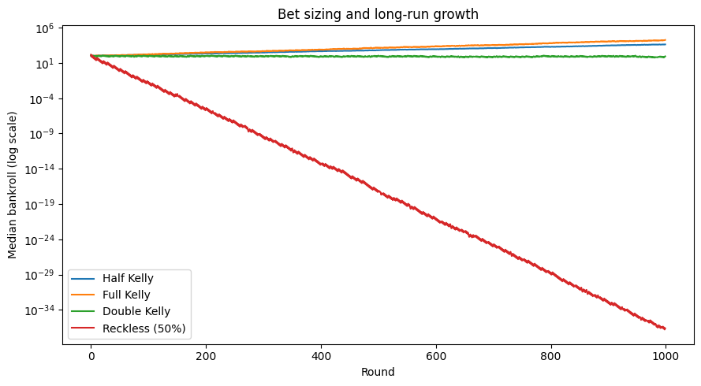

# Kelly Criterion Simulation

A Python Monte Carlo simulation of how much of your bankroll to bet when you have an edge. I built it to understand why over-betting destroys growth even when the odds are in your favour.

## The question

If you can repeatedly bet on a game where you have an advantage, what fraction of your bankroll should you stake each time? Bet too little and you grow slowly. Bet too much and a few bad streaks ruin you.

## How it works

- **The game:** a coin that wins 55% of the time and pays even money.
- **The Kelly fraction:** f = (b x p - (1 - p)) / b, which is 0.10 here, so bet 10% of the current bankroll each round.
- **The simulation:** 1,000 independent players each make 1,000 bets, always staking a fixed fraction of their current bankroll.
- **Strategies compared:** half Kelly (5%), full Kelly (10%), double Kelly (20%) and a reckless 50%.
- **What I measured:** median final bankroll, share of players who ended below where they started, median worst drawdown, and growth rate per round compared with the theoretical formula.

All data is simulated, so there is nothing to download.

## Results

## Limitations

- The win probability is known exactly, whereas real edges are uncertain and change over time.
- Bets are independent and the payout never changes.
- There are no trading costs, and bankroll can shrink without limit.
- A fixed fraction ignores that real bettors have limits on how much they can stake.

## Run it yourself

1. Click the Open In Colab badge at the top, or download kelly_simulation.ipynb and open it in Jupyter.
2. Run all cells. The settings at the top of the code let you change the win probability, odds and bet sizes.

## Possible next steps

- Cap the maximum drawdown and measure what it costs in growth.
- Bet on two independent games at once and split the Kelly fraction between them.
- Add a cost per bet and find the smallest edge that is still worth betting.
